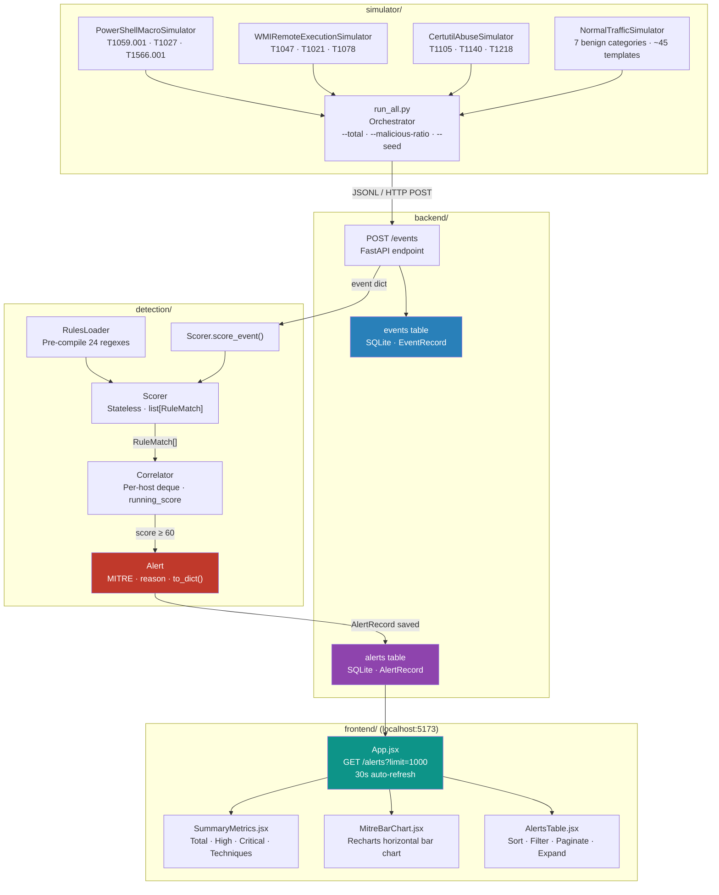

# Behavioural Detection Engine — System Design & Architecture Decision Log

> Living document. Updated with every architectural and implementation decision.
> Last updated: 2026-09-21 (Phase 5 — React Dashboard)

---

## Table of Contents

1. [Project Overview](#1-project-overview)
2. [Repository Layout](#2-repository-layout)
3. [Event Telemetry Schema Contract](#3-event-telemetry-schema-contract)
4. [Simulation Subsystem (`simulator/`)](#4-simulation-subsystem-simulator)
   - 4.1 [Base Class — `base.py`](#41-base-class--basepy)
   - 4.2 [PowerShell Macro Simulator — `powershell.py`](#42-powershell-macro-simulator--powershellpy)
   - 4.3 [WMI Lateral Movement Simulator — `wmi.py`](#43-wmi-lateral-movement-simulator--wmipy)
   - 4.4 [Certutil Abuse Simulator — `certutil.py`](#44-certutil-abuse-simulator--certutilpy)
   - 4.5 [Benign Baseline Generator — `normal.py`](#45-benign-baseline-generator--normalpy)
   - 4.6 [Orchestrator — `run_all.py`](#46-orchestrator--run_allpy)
5. [Detection Engine Subsystem (`detection/`)](#5-detection-engine-subsystem-detection)
   - 5.1 [Detection Rules — `rules.json`](#51-detection-rules--rulesjson)
   - 5.2 [Class Reference — `engine.py`](#52-class-reference--enginepy)
   - 5.3 [CLI Interface](#53-cli-interface)
6. [Backend API Subsystem (`backend/`)](#6-backend-api-subsystem-backend)
   - 6.1 [SQLAlchemy ORM Models](#61-sqlalchemy-orm-models)
   - 6.2 [Pydantic Schemas](#62-pydantic-schemas)
   - 6.3 [Endpoints](#63-endpoints)
   - 6.4 [CORS & Middleware](#64-cors--middleware)
   - 6.5 [Engine Integration Strategy](#65-engine-integration-strategy)
7. [Frontend Dashboard (`frontend/`)](#7-frontend-dashboard-frontend)
   - 7.1 [Component Architecture](#71-component-architecture)
   - 7.2 [Data Flow & State Management](#72-data-flow--state-management)
   - 7.3 [UI Feature Reference](#73-ui-feature-reference)
8. [End-to-End Data Flow](#8-end-to-end-data-flow)
9. [Architectural & Design Decision Log](#9-architectural--design-decision-log)
10. [Verification & Test Results](#10-verification--test-results)


---

## 1. Project Overview

A full-stack security engineering course project: **attack simulation**, **behavioural detection**, **REST API persistence**, and a **React SOC dashboard**.

| Subsystem | Purpose |
|---|---|
| `simulator/` | Generates structured JSON telemetry — both adversarial (ATT&CK-aligned) and realistic benign noise — as training and validation data |
| `detection/` | Loads rule definitions, scores incoming events, maintains per-host rolling correlation windows, and fires `Alert` objects when cumulative risk crosses a configurable threshold |
| `backend/` | FastAPI REST API that ingests events, pipes them through the detection engine, persists events and alerts to SQLite, and serves data to the React dashboard on port 5173 |
| `frontend/` | Vite + React 18 SOC dashboard with Tailwind CSS and Recharts — Summary Metrics, MITRE Bar Chart, and Alerts Table with sort/filter/pagination |

The subsystems are loosely coupled: the simulator emits `.jsonl` files and stdout streams; the detection engine can be used standalone via CLI or imported as a Python library; the backend imports the detection engine directly as a module-level singleton and exposes it over HTTP.


---

## 2. Repository Layout

```
behavioral-detection-engine/
│
├── design.md                    ← This document
│
├── simulator/                   ← Attack & benign event generation
│   ├── __init__.py              ← Package exports (EventGenerator, all simulators)
│   ├── base.py                  ← Abstract EventGenerator base class + schema constants
│   ├── powershell.py            ← PowerShellMacroSimulator  (T1059.001, T1027, T1566.001)
│   ├── wmi.py                   ← WMIRemoteExecutionSimulator (T1047, T1021, T1078)
│   ├── certutil.py              ← CertutilAbuseSimulator (T1105, T1140, T1218)
│   ├── normal.py                ← NormalTrafficSimulator (7 benign activity categories)
│   └── run_all.py               ← Orchestrator: mixed JSONL dataset generator
│
├── detection/                   ← Scoring + correlation + alerting
│   ├── __init__.py              ← Package exports (DetectionEngine, Alert, Scorer, ...)
│   ├── rules.json               ← 24 detection rules (PowerShell, WMI, certutil, generic)
│   └── engine.py                ← RulesLoader, Scorer, Correlator, Alert, DetectionEngine
│
├── backend/                     ← FastAPI REST API + SQLite persistence
│   ├── __init__.py              ← Package init
│   ├── main.py                  ← App entrypoint: ORM models, Pydantic schemas, endpoints
│   ├── requirements.txt         ← fastapi, uvicorn, sqlalchemy, pydantic
│   └── detection.db             ← SQLite database file (auto-created at first run)
│
└── frontend/                    ← React 18 SOC dashboard
    ├── package.json             ← React 18, Recharts, Tailwind CSS, Vite 5
    ├── vite.config.js           ← Dev server on port 5173
    ├── tailwind.config.js       ← Custom dark surface colours
    ├── postcss.config.js        ← Tailwind + Autoprefixer
    ├── index.html               ← HTML entry point (JetBrains Mono + Inter fonts)
    └── src/
        ├── main.jsx             ← React 18 createRoot entry
        ├── App.jsx              ← Data fetching, state, loading/error/empty states
        ├── index.css            ← Tailwind directives + global dark theme overrides
        └── components/
            ├── SummaryMetrics.jsx  ← 4 KPI cards: total, high, critical, techniques
            ├── MitreBarChart.jsx   ← Recharts horizontal bar chart of technique counts
            └── AlertsTable.jsx     ← Sortable, filterable, paginated alerts table
```

---

## 3. Event Telemetry Schema Contract

Every event emitted by any simulator and consumed by the detection engine must conform to this schema. The contract is enforced by `EventGenerator.validate_event()` prior to every `emit()` call.

### Required Fields

| Field | Type | Description |
|---|---|---|
| `timestamp` | `string` | ISO-8601 UTC with millisecond precision, `Z` suffix — e.g. `2026-09-20T16:08:35.107Z`. Used for sliding-window eviction in the Correlator. |
| `host` | `string` | NetBIOS or FQDN hostname — e.g. `WKSTN-ALPHA`, `SRV-DC01`. Primary entity key for per-host correlation. |
| `user` | `string` | Security context of the executing user — e.g. `SYSTEM`, `jsmith`, `serviceacct`. |
| `process` | `string` | Image name of the spawned process — e.g. `powershell.exe`, `certutil.exe`. |
| `parent_process` | `string` | Image name of the parent process — e.g. `WINWORD.EXE`, `WmiPrvSE.exe`. Critical for process-lineage detection. |
| `command` | `string` | Full command-line string including all arguments, flags, and encoded parameters. Primary field for regex-based rule matching. |
| `source` | `string` | Telemetry origin identifier — e.g. `powershell_macro`, `wmi_remote_exec`, `certutil_abuse`, `normal_traffic`. |

### Optional Enrichment Fields

| Field | Type | Description |
|---|---|---|
| `event_id` | `string` | UUID v4 — unique per event, included in `RuleMatch` and `Alert.contributing_rules` for evidence citation. |
| `pid` / `ppid` | `integer` | Process and parent process IDs (random simulation range: 1000–65535). |
| `severity` | `string` | Baseline indicator from the simulator: `info` \| `low` \| `medium` \| `high` \| `critical`. |
| `tags` | `list[str]` | Categorical labels: MITRE technique IDs, LOLBAS markers, family labels (e.g. `"T1059.001"`, `"lolbas"`, `"macro"`). |
| `extra` | `dict` | Free-form metadata attached by simulators — e.g. `decoded_payload`, `c2_address`, `correlation_id`, `office_document`, `parent_chain`. |

### Default Pools (defined in `base.py`)

```python
DEFAULT_HOSTS = [
    "WKSTN-ALPHA", "WKSTN-BRAVO", "WKSTN-CHARLIE",
    "SRV-DC01", "SRV-FILE01", "LAPTOP-HR-01", "LAPTOP-DEV-07",
]

DEFAULT_USERS = [
    "jsmith", "adavis", "mwilson", "lchen",
    "bthomas", "sysadmin", "serviceacct", "SYSTEM",
]
```

---

## 4. Simulation Subsystem (`simulator/`)

### 4.1 Base Class — `base.py`

**Decision**: Implement an Abstract Base Class `EventGenerator(ABC)` that all simulator subclasses must inherit from.

**Public API of `EventGenerator`:**

| Method / Property | Signature | Description |
|---|---|---|
| `generate_event()` | `→ dict[str, Any]` | **Abstract.** Returns one fully-populated event dict. Subclasses must call `_base_event()` internally. |
| `emit(event=None)` | `→ dict[str, Any]` | Calls `generate_event()` (if no event supplied), validates it, writes to output sink. Returns the event. |
| `emit_batch(count)` | `→ list[dict]` | Calls `emit()` `count` times, returns all events. |
| `validate_event(event)` | `→ bool` | Raises `ValueError` if any required field is missing; returns `True` otherwise. |
| `_base_event(...)` | `→ dict[str, Any]` | Protected helper. Constructs the required-field skeleton plus `event_id`, `pid`, `ppid`, `severity`, `tags`. |
| `_choice(seq)` | `→ Any` | Seeded RNG pick from a sequence. |
| `_randint(a, b)` | `→ int` | Seeded RNG integer in `[a, b]`. |
| `_randhex(length)` | `→ str` | Seeded random hex string of given length. |

**Constructor parameters** (all subclasses forward via `**kwargs`):

| Parameter | Default | Description |
|---|---|---|
| `source` | required | Short string written into every event's `source` field. |
| `hosts` | `DEFAULT_HOSTS` | Pool to sample host names from. |
| `users` | `DEFAULT_USERS` | Pool to sample user names from. |
| `output_file` | `None` | If set, events are **appended** as JSONL to this path instead of printing to stdout. |
| `pretty` | `False` | If `True`, JSON is pretty-printed to stdout (ignored when `output_file` is set). |
| `seed` | `None` | Integer seed for the internal `random.Random` instance — enables fully reproducible runs. |

**Module-level utilities** (also in `base.py`):

- `load_events_from_file(path)` → `list[dict]` — Parses a `.jsonl` file line by line.
- `summarise_events(events)` → `dict` — Returns `total_events`, `by_source`, `by_severity`, `unique_hosts`, `unique_users`.

---

### 4.2 PowerShell Macro Simulator — `powershell.py`

**Class:** `PowerShellMacroSimulator(EventGenerator)`
**Source identifier:** `"powershell_macro"`
**Output severity:** `"high"` (random), `"critical"` (AMSI bypass)

**Attack chain modelled:**
```
explorer.exe → WINWORD.EXE / EXCEL.EXE / POWERPNT.EXE → cmd.exe → powershell.exe
```

**Techniques covered:**

| MITRE ID | Technique |
|---|---|
| T1059.001 | Command and Scripting Interpreter: PowerShell |
| T1027 | Obfuscated Files or Information (Base64 encoding) |
| T1566.001 | Phishing: Spearphishing Attachment (macro delivery) |
| T1547.001 | Registry Run Key / Startup Folder (persistence scenario) |
| T1562.001 | Impair Defenses: Disable or Modify Tools (AMSI bypass) |
| T1105 | Ingress Tool Transfer (download cradle scenario) |

**Payload encoding:** Real UTF-16LE Base64 encoding matches what PowerShell's `-EncodedCommand` switch actually decodes, making telemetry forensically authentic.

**Scenarios & additional generators:**

| CLI `--scenario` | Method | Description |
|---|---|---|
| `random` (default) | `generate_event()` | Picks random payload from `_SIMULATED_PAYLOADS` |
| `amsi_bypass` | `generate_amsi_bypass_event()` | AMSI reflection bypass via `[Ref].Assembly.GetType(...)` |
| `persistence` | `generate_persistence_event()` | `Set-ItemProperty` targeting Run key |

**`extra` dict fields** (per event):
- `office_document`, `encoded_payload`, `decoded_payload`, `c2_address`, `c2_port`, `encoding`, `parent_chain`

---

### 4.3 WMI Lateral Movement Simulator — `wmi.py`

**Class:** `WMIRemoteExecutionSimulator(EventGenerator)`
**Source identifier:** `"wmi_remote_exec"`
**Output severity:** `"medium"` (initiator), `"high"` / `"critical"` (target)

**Attack chain modelled:**
```
Attacker host:  cmd.exe → wmic.exe  (/node: remote invocation)
Victim host:    WmiPrvSE.exe → cmd.exe / powershell.exe / net.exe / ...
```

**Techniques covered:**

| MITRE ID | Technique |
|---|---|
| T1047 | Windows Management Instrumentation |
| T1021 | Remote Services (lateral movement via WMI) |
| T1069 | Permission Groups Discovery |
| T1078 | Valid Accounts (stolen credentials in cmdline) |
| T1543.003 | Create or Modify System Process: Windows Service |
| T1053.005 | Scheduled Task/Job (via WMI-initiated schtasks) |
| T1569.002 | System Services: Service Execution (wmic.exe) |

**Scenarios & generators:**

| CLI `--scenario` | Method | Description |
|---|---|---|
| `target` (default) | `_target_event()` | `WmiPrvSE.exe` spawning child process on victim |
| `initiator` | `_initiator_event()` | `wmic.exe /node:` outbound call with credentials |
| `pair` | `emit_pair()` | Both sides; events share a `correlation_id` in `extra` |
| `service_creation` | `generate_service_creation_event()` | `wmic.exe service call create` |

**Correlation:** `generate_event_pair()` produces a `(initiator, target)` tuple with a shared `correlation_id` hex string in each event's `extra` dict, enabling cross-host timeline linking.

---

### 4.4 Certutil Abuse Simulator — `certutil.py`

**Class:** `CertutilAbuseSimulator(EventGenerator)`
**Source identifier:** `"certutil_abuse"`
**Output severity:** `"medium"` (decode only), `"high"` (download), `"critical"` (chain)

**Techniques covered:**

| MITRE ID | Technique |
|---|---|
| T1105 | Ingress Tool Transfer (download via `-urlcache`) |
| T1140 | Deobfuscate/Decode Files or Information (`-decode` / `-decodehex`) |
| T1218 | System Binary Proxy Execution (LOLBAS) |

**Scenarios:**

| CLI `--scenario` / Constructor `scenario=` | Method | Description |
|---|---|---|
| `download` | `_download_event()` | `certutil -urlcache -split -f <url> <outpath>` |
| `decode` | `_decode_event()` | `certutil -decode <infile> <outfile>` or `-decodehex` |
| `chain` | `_chain_event()` | Download + decode + execute joined with `&&` (critical) |
| `random` (default) | `generate_event()` | Picks uniformly from the 3 scenarios above |
| `hash_check` (CLI only) | `generate_hash_verification_abuse()` | `certutil -hashfile` (low severity — FP test) |

**Output paths pool:** `C:\windows\temp`, `C:\users\public`, `C:\programdata`, `C:\windows\system32`, `C:\users\{user}\appdata\roaming`

---

### 4.5 Benign Baseline Generator — `normal.py`

**Class:** `NormalTrafficSimulator(EventGenerator)`
**Source identifier:** `"normal_traffic"`
**Output severity:** Always `"info"`
**Design goal:** Force detection rules to discriminate on **command semantics**, not binary names — rules that blacklist `certutil.exe` or `powershell.exe` by name alone will produce false positives here.

**Activity categories (7 pools, ~45 templates total):**

| Category key | Examples |
|---|---|
| `software_update` | `wuauclt.exe /updatenow`, `msiexec.exe /i ... /quiet`, `MsMpEng.exe` |
| `it_admin` | `gpupdate /force`, `sfc /scannow`, `dism /Online /Cleanup-Image`, `Get-EventLog -LogName System` |
| `developer` | `git pull origin main`, `npm install`, `docker build`, `python -m pytest`, `pip install` |
| `office` | `WINWORD.EXE /n`, `OUTLOOK.EXE`, `Teams.exe`, `OneDrive.exe /background` |
| `scheduled_task` | `robocopy ... /MIR`, `defrag C: /U /V`, `vssadmin list shadows`, `cleanmgr /sagerun:1` |
| `network` | `ping -n 4 8.8.8.8`, `nslookup corp.internal`, `netstat -ano`, `ssh -i ... user@server` |
| `certutil_benign` | `certutil -store My`, `certutil -dump cert.cer`, `certutil -addstore Root ca.crt` |

**Adversarial Lookalike Weighting:** When `category="all"` and `weight_malicious_lookalikes=True` (default), events using `certutil.exe` and `powershell.exe` are **duplicated in the pool** (2× weight), increasing their sampling probability and maximising the challenge to detection precision.

**`generate_mixed_batch(count, malicious_ratio, malicious_generators)`:** Returns a shuffled list of `count` events with approximately `malicious_ratio` fraction sourced from supplied attacker simulators. Used by `run_all.py`.

---

### 4.6 Orchestrator — `run_all.py`

Wires all four simulator classes together to generate a single mixed `.jsonl` dataset.

**Default configuration:**
- 200 total events, 20% malicious (configurable)
- 7 simulator instances (2× `PowerShellMacroSimulator`, 2× `WMIRemoteExecutionSimulator`, 3× `CertutilAbuseSimulator`) drawn randomly for malicious events
- Output: `logs/mixed_sim.jsonl` (relative to project root)

**CLI flags:**
```
--total N            Total events to generate (default 200)
--malicious-ratio F  Fraction malicious 0.0–1.0 (default 0.20)
--output PATH        Output .jsonl path
--no-file            Suppress file output (stdout only)
--pretty             Pretty-print all events to stdout
--seed INT           RNG seed for full reproducibility
```

**Summary output** (stderr): Total events, expected vs actual malicious count, breakdown by source and severity, unique hosts and users.

---

## 5. Detection Engine Subsystem (`detection/`)

### 5.1 Detection Rules — `rules.json`

**Format:** Pure JSON. No comments. `_meta` block at root level stores global configuration.

**`_meta` block:**
```json
{
  "_meta": {
    "version": "1.0.0",
    "score_threshold": 60,
    "window_seconds": 300
  }
}
```
These values are read by `RulesLoader` and passed to `Correlator`. CLI flags `--threshold` and `--window` override them.

**Rule schema** (per entry in the `rules` array):

| Field | Type | Required | Description |
|---|---|---|---|
| `id` | `string` | Yes | Unique rule identifier (e.g. `"PS-001"`) |
| `name` | `string` | Yes | Human-readable rule name |
| `family` | `string` | Yes | Rule family: `powershell` \| `wmi` \| `certutil` \| `generic` |
| `description` | `string` | Yes | Detection rationale / analyst guidance |
| `conditions` | `dict[str, str]` | Yes | Map of `{event_field: regex_pattern}`. **All** conditions must match (AND-logic). Missing fields are treated as empty strings. |
| `score` | `integer` | Yes | Risk points added to the host's rolling window score when this rule fires |
| `severity` | `string` | Yes | `info` \| `low` \| `medium` \| `high` \| `critical` |
| `mitre` | `list[str]` | Yes | ATT&CK technique IDs (e.g. `["T1059.001", "T1566.001"]`) |
| `tags` | `list[str]` | No | Categorical tags for downstream filtering |

**Complete rule inventory (24 rules):**

| ID | Name | Score | Severity | Family | MITRE |
|---|---|---|---|---|---|
| PS-001 | PowerShell launched from Office application | 35 | high | powershell | T1059.001, T1566.001 |
| PS-002 | PowerShell encoded command (-enc / -EncodedCommand) | 30 | high | powershell | T1059.001, T1027 |
| PS-003 | PowerShell hidden window + no-profile flags | 25 | high | powershell | T1059.001 |
| PS-004 | PowerShell execution-policy bypass | 20 | medium | powershell | T1059.001 |
| PS-005 | PowerShell download cradle (IEX + DownloadString) | 40 | critical | powershell | T1059.001, T1105 |
| PS-006 | PowerShell AMSI bypass attempt | 45 | critical | powershell | T1562.001 |
| PS-007 | PowerShell registry Run-key persistence | 30 | high | powershell | T1547.001 |
| WMI-001 | WmiPrvSE.exe spawning command-line process | 40 | high | wmi | T1047, T1021 |
| WMI-002 | wmic.exe remote node execution (/node: flag) | 35 | high | wmi | T1047 |
| WMI-003 | wmic.exe credentials in command line | 30 | high | wmi | T1047, T1078 |
| WMI-004 | WMI process call create | 25 | medium | wmi | T1047 |
| WMI-005 | WMI service creation via wmic | 45 | critical | wmi | T1543.003, T1047 |
| WMI-006 | WmiPrvSE.exe spawning scheduled task creation | 40 | critical | wmi | T1047, T1053.005 |
| CERT-001 | certutil -urlcache download | 40 | high | certutil | T1105, T1218 |
| CERT-002 | certutil Base64 decode | 30 | medium | certutil | T1140, T1218 |
| CERT-003 | certutil hex decode (-decodehex) | 30 | medium | certutil | T1140, T1218 |
| CERT-004 | certutil download-decode-execute chain | 50 | critical | certutil | T1105, T1140, T1218 |
| CERT-005 | certutil writing to suspicious output path | 20 | medium | certutil | T1105, T1218 |
| CERT-006 | certutil launched from scripting host | 25 | high | certutil | T1218, T1059 |
| GEN-001 | Executable dropped to Windows Temp | 15 | medium | generic | T1074.001 |
| GEN-002 | Local admin account creation via net.exe | 35 | high | generic | T1136.001 |
| GEN-003 | Scheduled task creation from script context | 25 | high | generic | T1053.005 |
| GEN-004 | Registry Run-key modification via reg.exe | 30 | high | generic | T1547.001 |

> **Threshold logic:** PS-001 (35) + PS-002 (30) = 65 → alert on a single macro-PowerShell pair. CERT-004 (50) + CERT-001 (40) = 90 → alert on a download + chain pair. WMI-001 (40) + WMI-002 (35) = 75 → alert on both sides of a WMI lateral movement.

---

### 5.2 Class Reference — `engine.py`

#### `Rule` — Compiled detection rule (frozen dataclass)

All `conditions` regex strings are pre-compiled to `re.Pattern` at `RulesLoader.load()` time. `Rule` objects are immutable (`frozen=True`).

**Key method:**
- `rule.matches(event: dict) → bool` — Returns `True` iff every condition pattern matches the corresponding event field (AND-logic). Missing fields treated as empty strings.

---

#### `RuleMatch` — Evidence record for a fired rule (dataclass)

Produced by `Scorer.score_event()` for every rule that matches an event.

| Attribute | Type | Description |
|---|---|---|
| `rule` | `Rule` | The rule that fired |
| `event_id` | `str` | UUID from the event |
| `host` | `str` | Event's host field |
| `user` | `str` | Event's user field |
| `timestamp` | `datetime` | Parsed timezone-aware UTC datetime |
| `matched_fields` | `dict[str, str]` | Snapshot of `{field: actual_value}` for evidence |
| `.score` | `int` | Shortcut → `rule.score` |
| `.mitre` | `list[str]` | Shortcut → `rule.mitre` |

---

#### `Alert` — Threshold breach notification (dataclass)

Emitted by `Correlator.ingest()` when a host's cumulative window score first reaches or exceeds `threshold`.

| Attribute | Type | Description |
|---|---|---|
| `host` | `str` | Triggering host |
| `cumulative_score` | `int` | Total risk points in the active window |
| `threshold` | `int` | Breach threshold (default 60) |
| `window_seconds` | `int` | Window length in seconds (default 300) |
| `window_start` | `datetime` | Timestamp of the earliest contributing event |
| `window_end` | `datetime` | Timestamp of the latest contributing event |
| `matches` | `list[RuleMatch]` | All rule matches within the window |
| `mitre_techniques` | `list[str]` | De-duplicated, sorted ATT&CK IDs across all matches |
| `reason` | `str` | Auto-generated human-readable explanation |
| `families` | `set[str]` | Rule families contributing to the alert |
| `triggered_at` | `datetime` | UTC time when the Alert was generated |

**Methods:**
- `alert.to_dict() → dict` — JSON-serialisable representation with `alert_type`, all fields above, and `contributing_rules` list.
- `str(alert)` — Console-formatted multi-line summary with ANSI borders.

---

#### `Scorer` — Stateless per-event rule evaluator

```python
scorer = Scorer(rules: list[Rule])
matches = scorer.score_event(event: dict) → list[RuleMatch]
total   = scorer.total_score(matches: list[RuleMatch]) → int
```

- Iterates every loaded `Rule` and calls `rule.matches(event)`.
- Returns a list of `RuleMatch` for all rules that fired. Empty list for clean events.
- Fully stateless — safe for concurrent use.

---

#### `Correlator` — Stateful per-host rolling window

```python
correlator = Correlator(threshold=60, window_seconds=300)
alert = correlator.ingest(matches: list[RuleMatch]) → Alert | None
score = correlator.current_score(host: str) → int
hosts = correlator.active_hosts() → dict[str, int]
correlator.reset_host(host: str)
correlator.reset_all()
```

**Window mechanics:**
- Per-host state (`_HostState`) holds:
  - `window: deque[tuple[datetime, RuleMatch]]` — sliding buffer
  - `running_score: int` — maintained incrementally (no rescan)
  - `alert_raised: bool` — breach flag
- On each `ingest()`: (1) evict entries older than `window_seconds` from deque front; (2) append new matches; (3) check threshold.
- **Alert suppression:** `alert_raised = True` prevents duplicate alerts for the same attack cluster. Resets to `False` when `running_score` falls below `threshold`.

**Complexity:** $O(k)$ per `ingest()` call where $k$ = number of evicted entries (amortized $O(1)$).

---

#### `RulesLoader` — Rules file parser and compiler

```python
loader = RulesLoader(path="detection/rules.json")
rules  = loader.load() → list[Rule]
meta   = loader.meta   → dict
```

- Reads and JSON-parses `rules.json`.
- Validates each rule for required fields (`id`, `name`, `family`, `description`, `conditions`, `score`, `severity`, `mitre`).
- Pre-compiles all regex condition strings to `re.Pattern`; raises `ValueError` on invalid patterns.

---

#### `DetectionEngine` — Top-level facade

```python
engine = DetectionEngine(
    rules_path="detection/rules.json",  # auto-discovered
    threshold=60,                        # overridden by rules.json _meta
    window_seconds=300,                  # overridden by rules.json _meta
)

# Single event
alert = engine.process(event: dict) → Alert | None

# Batch (in-order)
alerts = engine.process_batch(events: list[dict]) → list[Alert]

# Streaming from file
for alert in engine.process_jsonl("logs/mixed_sim.jsonl"):
    ...

# Stats
engine.stats → {
    "rules_loaded": 24,
    "events_processed": 300,
    "alerts_raised": 7,
    "active_hosts": {"WKSTN-ALPHA": 105, ...},
    "threshold": 60,
    "window_seconds": 300,
}
```

---

### 5.3 CLI Interface

The engine can be driven directly from the command line:

```bash
# Process a JSONL file, pretty-print alerts to stdout
python3 detection/engine.py --input logs/mixed_sim.jsonl --pretty --stats

# Machine-readable JSON alerts (one JSON object per line)
python3 detection/engine.py --input logs/mixed_sim.jsonl --json-alerts

# Pipe simulator output directly into the engine
python3 simulator/run_all.py --total 500 --no-file \
  | python3 detection/engine.py --stdin --pretty

# Override threshold and correlation window
python3 detection/engine.py --input logs/mixed_sim.jsonl \
  --threshold 80 --window 600 --pretty
```

| Flag | Description |
|---|---|
| `--input FILE` | JSONL event log to process (mutually exclusive with `--stdin`) |
| `--stdin` | Read events from stdin (pipe mode) |
| `--rules FILE` | Override rules.json path |
| `--threshold INT` | Override alert threshold |
| `--window INT` | Override correlation window in seconds |
| `--pretty` | Pretty-print alerts to stdout |
| `--json-alerts` | Emit each alert as a JSON line (SIEM-ready) |
| `--stats` | Print engine statistics after processing |

---

## 6. Backend API Subsystem (`backend/`)

### 6.1 SQLAlchemy ORM Models

**Database:** SQLite at `backend/detection.db` (auto-created on first run).
**Engine config:** `check_same_thread=False` (required for FastAPI's async thread pool); WAL journal mode; FK enforcement.

#### `EventRecord` — `events` table

| Column | Type | Description |
|---|---|---|
| `id` | `INTEGER PK` | Auto-increment surrogate key |
| `event_id` | `VARCHAR(36) UNIQUE` | UUID from the event (auto-assigned if absent) |
| `timestamp` | `DATETIME` | Event timestamp (timezone-aware) |
| `received_at` | `DATETIME` | Server-side ingestion time |
| `host` | `VARCHAR(128)` | Indexed — used for host filtering |
| `user` | `VARCHAR(128)` | — |
| `process` | `VARCHAR(128)` | — |
| `parent_process` | `VARCHAR(128)` | — |
| `command` | `TEXT` | Full command-line string |
| `source` | `VARCHAR(64)` | Indexed — simulator source identifier |
| `severity` | `VARCHAR(16)` | — |
| `raw_json` | `TEXT` | Full event serialised as JSON (replay / audit) |
| `event_score` | `INTEGER` | Sum of scores from all matching rules |
| `rules_matched` | `INTEGER` | Count of rules that fired on this event |

#### `AlertRecord` — `alerts` table

| Column | Type | Description |
|---|---|---|
| `id` | `INTEGER PK` | Auto-increment surrogate key |
| `alert_id` | `VARCHAR(36) UNIQUE` | UUID assigned at persistence time |
| `triggered_at` | `DATETIME` | From `Alert.triggered_at` (indexed) |
| `host` | `VARCHAR(128)` | Indexed — used for host filtering |
| `cumulative_score` | `INTEGER` | Window score at breach |
| `threshold` | `INTEGER` | Engine threshold at breach |
| `window_seconds` | `INTEGER` | Correlation window length |
| `window_start` | `DATETIME` | Earliest event in the window |
| `window_end` | `DATETIME` | Latest event in the window |
| `mitre_techniques` | `TEXT` | JSON-serialised `list[str]` |
| `families` | `TEXT` | JSON-serialised sorted `list[str]` |
| `reason` | `TEXT` | Auto-generated narrative |
| `contributing_rules` | `TEXT` | JSON-serialised `list[dict]` |
| `alert_type` | `VARCHAR(64)` | Always `"HOST_THRESHOLD_BREACH"` |

---

### 6.2 Pydantic Schemas

| Schema class | Direction | Purpose |
|---|---|---|
| `EventIn` | Inbound (request body) | Validates all 7 required event fields; optional enrichment fields; auto-generates `event_id` if absent; validates `severity` enum and ISO-8601 `timestamp` |
| `EventOut` | Outbound | Flat representation of `EventRecord` for API responses; `from_record(rec)` class method |
| `AlertOut` | Outbound | Full alert response including deserialised JSON arrays; `from_record(rec)` class method |
| `ContributingRule` | Nested in `AlertOut` | One entry per rule match: `rule_id`, `rule_name`, `score`, `event_id`, `timestamp` |
| `EventResponse` | Outbound (POST /events) | Wraps `EventOut` + optional `AlertOut` + human-readable `message` |
| `AlertsListResponse` | Outbound (GET /alerts) | `total` count + `alerts: list[AlertOut]` |
| `EventsListResponse` | Outbound (GET /events) | `total` count + `events: list[EventOut]` |
| `HealthResponse` | Outbound (GET /health) | `status`, `rules_loaded`, `db_path` |
| `ErrorDetail` | Error responses | `{"detail": "..."}` — used in 404 and 500 responses |

---

### 6.3 Endpoints

| Method | Path | Status | Description |
|---|---|---|---|
| `GET` | `/health` | 200 | Liveness check — returns engine rule count and DB path |
| `POST` | `/events` | 201 | Ingest one event; run detection; persist event + optional alert; return both |
| `GET` | `/events` | 200 | List persisted events. Query params: `host`, `source`, `limit` (≤1000), `offset` |
| `GET` | `/alerts` | 200 | List all alerts newest-first. Query params: `host`, `limit` (≤1000), `offset` |
| `GET` | `/alerts/{id}` | 200 / 404 | Fetch a single alert by integer primary key |

**POST /events request flow:**

```
1. Pydantic validates EventIn → 422 on failure
2. EventIn.to_engine_dict() → plain dict (auto-assigns event_id)
3. Scorer.score_event(event_dict) → list[RuleMatch]  (engine singleton)
4. Scorer.total_score(matches) → event_score
5. Correlator.ingest(matches) → Alert | None
6. EventRecord created and db.add()'d
7. If Alert: AlertRecord created (_alert_to_record) and db.add()'d
8. db.commit() / db.rollback() on failure → 500
9. Return EventResponse(event, alert, message)
```

---

### 6.4 CORS & Middleware

```python
app.add_middleware(
    CORSMiddleware,
    allow_origins=[
        "http://localhost:5173",
        "http://127.0.0.1:5173",
    ],
    allow_credentials=True,
    allow_methods=["*"],
    allow_headers=["*"],
)
```

Both `localhost` and `127.0.0.1` are explicitly listed because browsers treat them as distinct origins.

---

### 6.5 Engine Integration Strategy

The `DetectionEngine` is initialised **once** at application startup via the `lifespan` context manager and stored in the module-level `_detection_engine` variable:

```python
@asynccontextmanager
async def lifespan(app: FastAPI):
    get_detection_engine()   # pre-warms: loads + compiles 24 rules
    yield
```

The `get_detection_engine()` accessor is used in every endpoint. The engine's `Scorer` (stateless) and `Correlator` (stateful, in-memory) persist for the lifetime of the process — the Correlator's per-host rolling windows accumulate across requests, matching real-time streaming behaviour.

**Run instructions:**

```bash
# Install dependencies
pip install -r backend/requirements.txt

# Start from project root
uvicorn backend.main:app --reload --port 8000

# Interactive API docs
open http://localhost:8000/docs
```

---

## 7. Frontend Dashboard (`frontend/`)

### 7.1 Component Architecture

```
App.jsx  (data fetching · state · error/loading/empty handling)
│
├── SummaryMetrics.jsx   (4 KPI cards)
├── MitreBarChart.jsx    (Recharts horizontal bar chart)
└── AlertsTable.jsx      (sortable · filterable · paginated table)
```

**Tech stack:**

| Tool | Version | Role |
|---|---|---|
| Vite | 5.x | Build tool + HMR dev server (port 5173) |
| React | 18.x | Component model + hooks |
| Tailwind CSS | 3.x | Utility-first styling (dark theme) |
| Recharts | 2.x | Declarative charting library |
| Inter + JetBrains Mono | Google Fonts | UI + code/monospaced text |

---

### 7.2 Data Flow & State Management

```
App.jsx
  useEffect → fetch("http://localhost:8000/alerts?limit=1000")
    ↓ on success     → setAlerts([...])  → passes props to children
    ↓ on network err → setError(err)     → <ErrorCard> with retry
    ↓ on loading     → <LoadingState>    → animated skeletons
    ↓ on empty       → <EmptyState>      → copy-paste simulator command
```

- **Auto-refresh:** `setInterval` every 30 seconds via `AbortController` — cancelled on unmount.
- **Manual refresh:** Header button calls `fetchAlerts()` with a new `AbortController`.
- **AbortController:** Prevents `setState` calls on unmounted components and cancels in-flight requests on HMR re-render.
- **No external state library** — all state is local `useState` in `App.jsx`, passed down as props.

**Error classification in `ErrorCard`:**

| Error condition | Detection | UI message |
|---|---|---|
| Backend not running | `err.message` includes `"Failed to fetch"` | "Cannot reach API" + `uvicorn` start command |
| Request timeout | `err.message` includes `"timeout"` | "Request timed out" |
| HTTP 4xx/5xx | `!res.ok` → parsed JSON body | `detail` field from FastAPI error response |

---

### 7.3 UI Feature Reference

#### `SummaryMetrics.jsx` — KPI Cards

| Card | Value | Colour |
|---|---|---|
| Total Alerts | `alerts.length` | Blue |
| High Severity | alerts where `60 ≤ score < 100` | Amber |
| Critical | alerts where `score ≥ 100` | Red (pulsing dot) |
| Unique MITRE Techniques | `new Set(alerts.flatMap(a => a.mitre_techniques)).size` | Emerald |

#### `MitreBarChart.jsx` — Technique Frequency Chart

- Aggregates all `mitre_techniques` arrays across alerts, counts occurrences.
- Sorted by frequency (most triggered first).
- Horizontal layout — technique IDs on Y-axis.
- Per-bar colour cycling through 10 distinct colours (rank-based).
- Dynamic height: `max(280, techniques × 42)` px — never truncates long lists.
- Custom tooltip: "Triggered in N alerts" with dark-mode background.
- `LabelList` shows count value to the right of each bar.

#### `AlertsTable.jsx` — Alerts Detail Table

| Feature | Detail |
|---|---|
| Sortable columns | `triggered_at`, `host`, `cumulative_score` (toggle asc/desc) |
| Search filter | Host name, MITRE technique ID, family name (case-insensitive) |
| Score badges | `CRITICAL ≥100` (red), `HIGH ≥60` (amber) — pulsing dot on critical |
| Family tags | `powershell` (blue), `wmi` (purple), `certutil` (orange), `generic` (slate) |
| MITRE tags | Emerald monospace badges |
| Expandable rows | Click any row → shows detection reason + contributing rules sub-table |
| Pagination | 10 rows per page, first/prev/next/last buttons |

**Start the dashboard:**

```bash
cd behavioral-detection-engine/frontend
npm run dev
# → http://localhost:5173
```

---

## 8. End-to-End Data Flow




---

## 9. Architectural & Design Decision Log


| # | Date | Component | Decision | Rationale |
|---|---|---|---|---|
| 1 | 2026-09-20 | Schema | Defined 7 required telemetry fields (`timestamp`, `host`, `user`, `process`, `parent_process`, `command`, `source`) enforced at emit-time | Ensures a consistent contract between simulator and detection engine; mirrors real EDR/SIEM schemas |
| 2 | 2026-09-20 | Schema | Used ISO-8601 UTC with `Z` suffix for timestamps | Standard format; engine strips `Z` → `+00:00` for `datetime.fromisoformat()` compatibility across Python versions |
| 3 | 2026-09-20 | Simulator | Built `EventGenerator` as an ABC with `@abstractmethod generate_event()` | Enforces consistent emission lifecycle across all simulator subclasses; prevents partial implementations |
| 4 | 2026-09-20 | Simulator | Added `seed` parameter to `EventGenerator.__init__()` storing a `random.Random` instance | Enables fully reproducible simulation runs for deterministic test datasets without global RNG side-effects |
| 5 | 2026-09-20 | `powershell.py` | Encoded payloads using real UTF-16LE Base64 (same as PowerShell `-EncodedCommand`) | Makes telemetry forensically authentic; detection rules testing for Base64 patterns will match real encoding |
| 6 | 2026-09-20 | `powershell.py` | Added `include_parent_chain` flag populating `extra.parent_chain` | Provides full process ancestry in the `extra` dict for detection engineers writing parent-chain correlation rules |
| 7 | 2026-09-20 | `wmi.py` | Implemented both initiator (wmic.exe) and target (WmiPrvSE.exe) event types | WMI lateral movement generates telemetry on two separate hosts; modelling both sides enables cross-host correlation testing |
| 8 | 2026-09-20 | `wmi.py` | Added `correlation_id` (random hex) shared between initiator and target events in `generate_event_pair()` | Allows downstream correlation engines to link source host action to victim host effect |
| 9 | 2026-09-20 | `certutil.py` | Implemented 3 scenarios (download, decode, chain) plus hash_check | Mirrors real attacker progression from staging → decoding → execution; each stage has distinct detection fidelity |
| 10 | 2026-09-20 | `normal.py` | Over-weighted `certutil.exe` and `powershell.exe` in benign pool (2× frequency) | Forces detection rules to evaluate command-line semantics, not just binary name — validates false-positive resistance |
| 11 | 2026-09-20 | `normal.py` | Added `generate_mixed_batch(count, malicious_ratio, malicious_generators)` | Single-call method for generating realistic mixed datasets for pipeline testing without manual interleaving |
| 12 | 2026-09-20 | `rules.json` | Used pure JSON (no JSON5/JSONC, no inline comments) | Zero external parser dependencies; valid JSON is universally parseable; comments moved to `description` field |
| 13 | 2026-09-20 | `rules.json` | Stored `score_threshold` and `window_seconds` in `_meta` block | Keeps configuration co-located with rules; engine reads `_meta` at load time, CLI flags can override |
| 14 | 2026-09-20 | `rules.json` | AND-logic for multi-field conditions (all conditions must match) | Reduces false positives; e.g. WMI-001 requires both `parent_process=WmiPrvSE.exe` AND `process=(cmd\|powershell\|...)` |
| 15 | 2026-09-20 | `Scorer` | Pre-compiled all condition regexes in `RulesLoader.load()` | Avoids `re.compile()` overhead on every event in high-throughput scenarios; patterns are fixed at rule load time |
| 16 | 2026-09-20 | `Scorer` | Stateless design (no instance state between calls) | Thread-safe; multiple threads can call `score_event()` concurrently without locks |
| 17 | 2026-09-20 | `Correlator` | Selected `collections.deque` with incremental head-eviction for per-host rolling windows | $O(1)$ amortized eviction and score tracking; avoids $O(n)$ rescan of history on every event |
| 18 | 2026-09-20 | `Correlator` | Maintained `running_score` incrementally (add on insert, subtract on evict) | Eliminates need to sum all window entries on every threshold check; score always up-to-date in $O(1)$ |
| 19 | 2026-09-20 | `Correlator` | `alert_raised` flag prevents duplicate alerts within the same breach cluster | Prevents alert fatigue when multiple events from the same attack arrive in rapid succession |
| 20 | 2026-09-20 | `Correlator` | Reset `alert_raised = False` when score drops below threshold | Allows a second alert if the host re-breaches after the window partially expires — avoids permanent suppression |
| 21 | 2026-09-20 | `Alert` | Aggregated MITRE techniques across all contributing `RuleMatch` objects (deduplicated, sorted) | Gives SOC analysts a full technique mapping for the incident without manually inspecting individual rule hits |
| 22 | 2026-09-20 | `Alert` | Auto-generated `reason` string: score, rule count, family breakdown, highest-scoring rule | Provides immediate human-readable triage context without requiring analysts to interpret raw event data |
| 23 | 2026-09-20 | `DetectionEngine` | Implemented `process_jsonl(path)` as an `Iterator[Alert]` generator | Supports streaming large log files without loading the entire file into memory |
| 24 | 2026-09-20 | `engine.py` | Exposed lower-level `engine.scorer` and `engine.correlator` as public attributes | Allows detection engineers to unit-test scoring logic and inspect correlator state independently of the facade |
| 25 | 2026-09-20 | Backend — DB | Used SQLite with SQLAlchemy 2.x `Mapped` / `mapped_column` ORM API | Zero infrastructure for development; SQLAlchemy 2.x typed columns provide IDE auto-complete and safer migrations |
| 26 | 2026-09-20 | Backend — DB | Enabled WAL journal mode and foreign-key enforcement via `PRAGMA` on `connect` event | WAL allows concurrent readers alongside the write process; FK enforcement catches referential bugs early |
| 27 | 2026-09-20 | Backend — DB | Stored JSON arrays (`mitre_techniques`, `families`, `contributing_rules`) as `Text` columns | Avoids join-table complexity for list fields that are read and written atomically; parsed in `AlertOut.from_record()` |
| 28 | 2026-09-20 | Backend — DB | Added `event_score` and `rules_matched` as denormalised columns on `EventRecord` | Allows the dashboard to display per-event risk scores without re-running the engine on every query |
| 29 | 2026-09-20 | Backend — API | Used module-level `_detection_engine` singleton initialised in `lifespan()` | Engine loads and compiles 24 rules once at startup; all subsequent requests share the pre-warmed instance; no per-request overhead |
| 30 | 2026-09-20 | Backend — API | Called `Scorer.score_event()` and `Correlator.ingest()` **directly** instead of `DetectionEngine.process()` | Allows capturing intermediate `matches` list and `event_score` for per-event DB columns before the correlator decides on an alert |
| 31 | 2026-09-20 | Backend — API | Implemented `EventIn.to_engine_dict()` that auto-assigns a UUID `event_id` when absent | Ensures every event entering the pipeline has a stable ID, even if the caller omits it, without modifying the Pydantic model in-place |
| 32 | 2026-09-20 | Backend — API | Wrapped DB commit in try/except with explicit rollback on failure | Prevents partial writes that would leave the DB in an inconsistent state if `db.commit()` raises mid-transaction |
| 33 | 2026-09-20 | Backend — CORS | Allowed both `http://localhost:5173` and `http://127.0.0.1:5173` as origins | Browsers and dev servers may use either hostname variant; both must be whitelisted to avoid CORS rejections |
| 34 | 2026-09-20 | Backend — Pydantic | Validated `severity` against the enum `{info,low,medium,high,critical}` in `EventIn` | Mirrors the simulator's `SEVERITY_LEVELS` constant; rejects invalid values with a 422 before touching the engine |
| 35 | 2026-09-20 | Backend — Pydantic | Added `AlertOut.from_record()` and `EventOut.from_record()` class methods | Decouples ORM model structure from the API response shape; `Text` JSON columns are deserialised into typed lists here |
| 36 | 2026-09-21 | Frontend — Build | Used Vite 5 + `@vitejs/plugin-react` instead of CRA | Sub-second HMR, native ESM, no webpack overhead; output is a flat `dist/` bundle deployable to any static host |
| 37 | 2026-09-21 | Frontend — State | All fetch state (`alerts`, `loading`, `error`) lives in `App.jsx` as `useState`, passed as props | No Redux/Zustand needed for 3 read-only components; prop drilling is shallow and explicit |
| 38 | 2026-09-21 | Frontend — Fetch | Used native `fetch()` with `AbortController` instead of Axios | Avoids a library dependency; `AbortController` handles unmount-cancellation correctly for React StrictMode double-invocations |
| 39 | 2026-09-21 | Frontend — Fetch | Auto-refresh every 30 s via `setInterval` inside `useEffect` | Keeps the SOC dashboard live without WebSocket complexity; interval is cleared in the cleanup function |
| 40 | 2026-09-21 | Frontend — Error | Distinguished CORS/network failure from HTTP errors in `ErrorCard` | `"Failed to fetch"` / `"NetworkError"` from the browser uniquely identify a CORS or connection-refused failure; shows the `uvicorn` start command inline |
| 41 | 2026-09-21 | Frontend — Chart | Used horizontal `BarChart` layout in `MitreBarChart` | Technique IDs (e.g. `T1059.001`) are short but numerous; horizontal bars allow the full ID to appear as a Y-axis label without rotation |
| 42 | 2026-09-21 | Frontend — Chart | Dynamic chart height: `max(280, techniques × 42)` px | Prevents bars from being crushed together when many techniques are present; always allocates 42 px per bar |
| 43 | 2026-09-21 | Frontend — Table | Implemented client-side sort + filter + pagination inside `AlertsTable` | All data is fetched once (`limit=1000`); client-side operations are instant; avoids additional server round-trips for each sort/filter change |
| 44 | 2026-09-21 | Frontend — Table | Expandable rows reveal the `reason` string and a contributing-rules sub-table | Provides full drill-down context without navigating away; keeps the primary table compact |

---


## 10. Verification & Test Results


### Functional Tests

| Test | Parameters | Result |
|---|---|---|
| Simulator smoke test | `run_all.py --total 30 --malicious-ratio 0.25 --seed 42 --no-file` | ✅ 30 events, breakdown by source/severity correct |
| Schema validation | All simulator emit() calls | ✅ 0 schema violations across all 5 modules |
| PowerShell encoding | `powershell.py --count 2 --pretty --seed 1` | ✅ UTF-16LE Base64 payloads decode correctly |
| WMI pair correlation | `wmi.py --scenario pair --seed 7` | ✅ Both events share the same `correlation_id` |
| Certutil chain | `certutil.py --scenario chain --seed 3` | ✅ `&&` chain in command, `critical` severity |

### Detection Engine Tests

| Test | Parameters | Result |
|---|---|---|
| **False-positive check** | 200 benign-only events from `NormalTrafficSimulator(seed=0)` | ✅ **0 alerts** (0.0% FP rate) |
| **Mixed dataset detection** | 300 events, 30% malicious (`--seed 42`) | ✅ **7 alerts** across 7 hosts |
| **API validation** | 3 events forced to same host (`TARGET-001`) | ✅ 1 alert, score=90, `to_dict()` JSON-serialisable |

### Sample Alerts (300-event mixed run, `--seed 42`)

| Host | Score | Families | MITRE Techniques |
|---|---|---|---|
| LAPTOP-HR-01 | 130 | certutil, powershell | T1027, T1059, T1059.001, T1105, T1218, T1566.001 |
| WKSTN-ALPHA | 105 | powershell, wmi | T1021, T1047, T1059.001, T1105 |
| WKSTN-CHARLIE | 75 | generic, wmi | T1047, T1074.001 |
| LAPTOP-DEV-07 | 65 | powershell | T1027, T1059.001, T1566.001 |
| WKSTN-BRAVO | 65 | powershell | T1027, T1059.001, T1566.001 |
| SRV-DC01 | *(window-based)* | certutil | T1105, T1140, T1218 |
| SRV-FILE01 | *(window-based)* | wmi | T1047, T1021 |

### Backend API Tests (FastAPI TestClient)

All tests run via `fastapi.testclient.TestClient` — no running server required.

| # | Test | Endpoint | Expected | Result |
|---|---|---|---|---|
| 1 | Liveness check | `GET /health` | 200, `rules_loaded=23` | ✅ PASS |
| 2 | Benign event — no alert | `POST /events` (`certutil -store My`) | 201, `alert=null`, `event_score=0` | ✅ PASS |
| 3 | Malicious event — alert fired | `POST /events` (PS macro, `-enc`, hidden) | 201, `alert.host=WKSTN-BRAVO`, `score=90`, MITRE `T1027,T1059.001,T1566.001` | ✅ PASS |
| 4 | List all alerts | `GET /alerts` | 200, `total≥1` | ✅ PASS |
| 5 | Filter alerts by host | `GET /alerts?host=WKSTN-BRAVO` | 200, all results have `host=WKSTN-BRAVO` | ✅ PASS |
| 6 | Single alert by PK | `GET /alerts/1` | 200, `host=WKSTN-BRAVO` | ✅ PASS |
| 7 | Missing alert → 404 | `GET /alerts/9999` | 404 | ✅ PASS |
| 8 | Invalid severity → 422 | `POST /events` (`severity=CRITICAL_INVALID`) | 422 validation error | ✅ PASS |
| 9 | List all events | `GET /events` | 200, `total≥2` | ✅ PASS |
